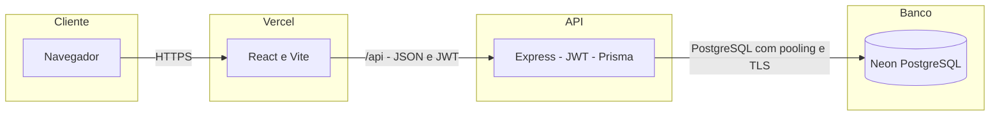

# AtivoControl

Gestão de armamentos, munições, responsáveis e movimentações com React, Express, Prisma e PostgreSQL no Neon.

[Aplicação online](https://ativocontrol.vercel.app) · [Swagger](https://ativocontrol.vercel.app/api/docs) · [OpenAPI](https://ativocontrol.vercel.app/api/openapi.json)


> Indicadores, gráficos e alertas do painel são demonstrativos. Os módulos de cadastro consultam a API e o Neon. A identidade visual SSP/BA não comprova vínculo ou homologação institucional.

## Documentação

| Documento | Conteúdo |
| --- | --- |
| [Guia e galeria](docs/GUIA.md) | Prints completos, instruções e vídeos. |
| [Mapas](docs/ARQUITETURA.md) | Produção, Docker, navegação e dados. |
| [API](docs/API.md) | Endpoints, autenticação e exemplos. |
| [Operação](docs/OPERACAO.md) | Instalação, Neon, Docker e Vercel. |

## Vídeos

[](docs/media/tour-aplicacao.webm)

[Assistir/baixar tour da aplicação](https://raw.githubusercontent.com/PauloHenrique993940/AtivoControl/main/docs/media/tour-aplicacao.webm) · [Assistir/baixar tour do Swagger](https://raw.githubusercontent.com/PauloHenrique993940/AtivoControl/main/docs/media/tour-swagger.webm)

Gravações reais WebM, sem narração e sem senhas ou tokens visíveis. No GitHub, use **View raw/Download** se o player não aparecer.

## Galeria

| Login | Armamentos |
| --- | --- |
|  |  |
| **Munições** | **Movimentações** |
|  |  |
| **Responsáveis** | **Swagger** |
|  |  |

As dez capturas completas estão no [guia](docs/GUIA.md).

## Arquitetura



Veja os [mapas completos](docs/ARQUITETURA.md), incluindo as relações entre tabelas.

## Executar localmente

Use Node.js 22 ou superior compatível e npm. Copie `backend/.env.example` para `backend/.env` e configure URLs Neon, `JWT_SECRET`, `ADMIN_EMAIL` e `ADMIN_PASSWORD`.

```sh
npm ci
npm run db:deploy
npm run db:seed --workspace backend
```

Em terminais separados:

```sh
npm run dev --workspace backend
npm run dev --workspace frontend
```

Frontend em `http://localhost:5173`; Swagger em `http://localhost:3333/docs`. No PowerShell com scripts bloqueados, use `npm.cmd` e `npx.cmd`.

## Docker

Com Docker Desktop ativo e `backend/.env` configurado:

```sh
docker compose build
docker compose run --rm api npm run db:deploy
docker compose run --rm api npm run db:seed --workspace backend
docker compose up -d
```

Frontend: `http://localhost:8080`. Swagger: `http://localhost:8080/api/docs`. O banco permanece no Neon.

## Vercel

Publique a raiz com `vercel.json`. Configure `DATABASE_URL`, `DIRECT_URL` e `JWT_SECRET` na Vercel. `CORS_ORIGIN` permite clientes em outra origem; `VITE_API_URL` substitui `/api` no build do frontend.

```sh
npm run build
npx vercel --prod
```

Aplique migrações antes de publicar alterações de schema. Builds não executam migrações ou seed. Detalhes em [operação](docs/OPERACAO.md).

## Estado atual

- Login JWT, listagem e criação nos quatro módulos; atualização e exclusão de armamentos.
- Retirada e devolução alteram o status do armamento associado.
- Dashboard, alertas, busca global e configurações têm partes demonstrativas.
- Exportação PDF/Excel, auditoria automática e autorização por papel estão pendentes.
- Movimentações não descontam munições e não atualizam armamentos em transação única.
- Dados dos arquivos SQLite antigos não foram importados para o PostgreSQL.

Builds, Docker, Neon, login, listagens autenticadas, rejeição sem token e navegação foram verificados. Ainda não há suíte de testes de negócio; consulte [verificações e limites](docs/OPERACAO.md).
