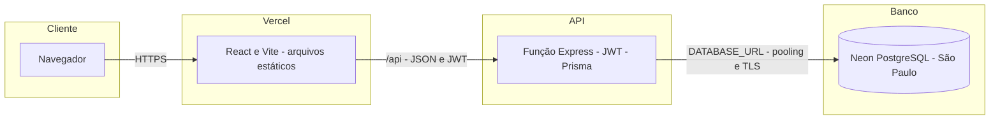
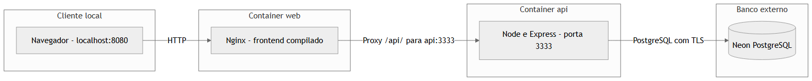
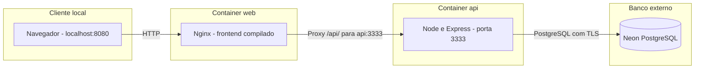
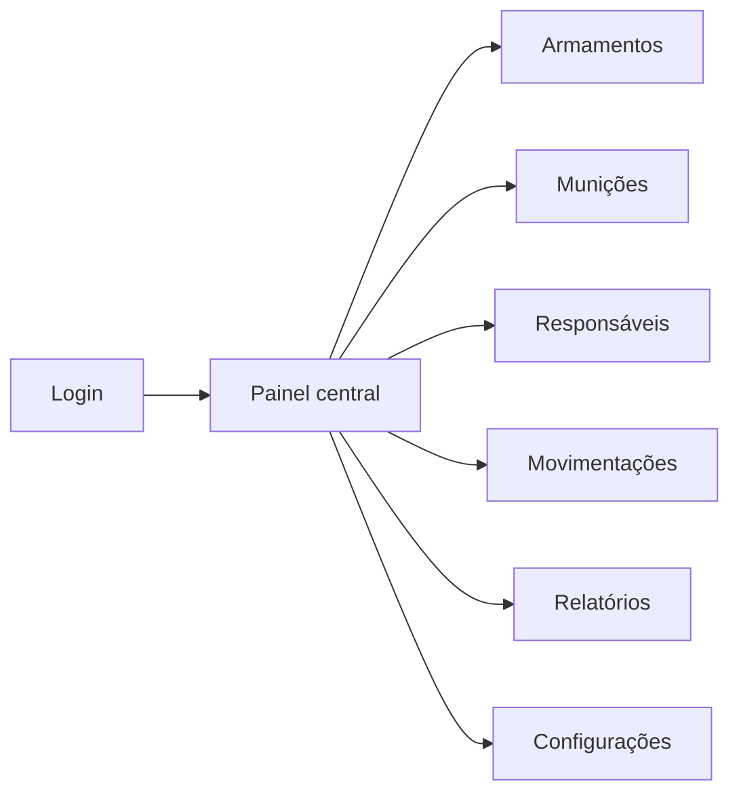
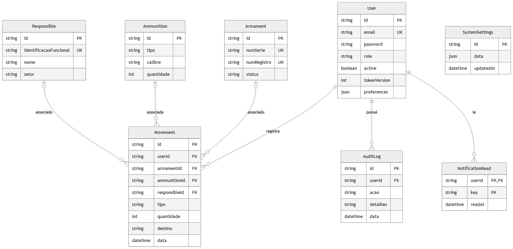
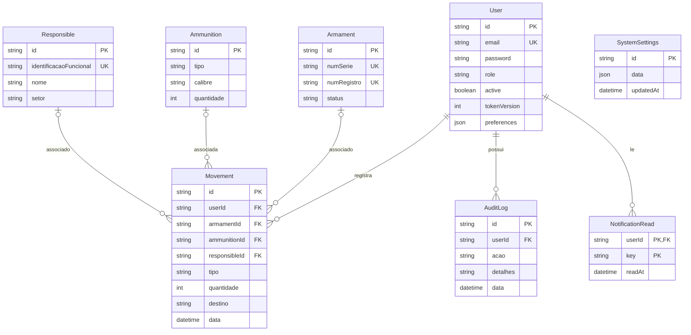

# Mapas da arquitetura

[README](../README.md) · [Operação](OPERACAO.md)

## Produção

A Vercel serve `frontend/dist` e encaminha `/api/*` para `api/index.ts`. O backend remove o prefixo antes de executar as rotas. URLs da interface usam fallback de SPA. Prisma usa `DATABASE_URL` para consultas e `DIRECT_URL` para migrações. Builds não alteram o banco.

## Docker

[Vers?o vetorial SVG](media/mapa-docker.svg)

O Compose não cria PostgreSQL local. A API recebe `backend/.env`; o Nginx faz proxy para `api`. Healthcheck consulta `/health`. Na porta direta 3333, as rotas não precisam de `/api`.

## Navegação

## Dados

[Vers?o vetorial SVG](media/mapa-dados.svg)

Todo movimento tem usuário; os demais vínculos são opcionais. Senhas são hashes bcrypt. Tipo, status e papel são strings, sem enum no banco. Veja o [schema completo](../backend/prisma/schema.prisma).

## Organização

| Caminho | Responsabilidade |
| --- | --- |
| `api/index.ts` | Entrada da função Vercel. |
| `backend/server.ts` | Express, Swagger e saúde. |
| `backend/routes/`, `services/`, `middlewares/` | Endpoints, regras de negócio e JWT. |
| `backend/lib/domain.ts` | Validação, transações, permissões e erros. |
| `backend/prisma/` | Schema, migrações e seed. |
| `backend/docs/openapi.ts` | Especificação OpenAPI. |
| `frontend/src/pages/` | Telas. |
| `frontend/src/context/`, `services/` | Sessão e Axios. |
| `docs/media/`, `scripts/capture-docs.cjs` | Capturas e gravação reproduzível. |
| `Dockerfile`, `frontend/Dockerfile`, `compose.yaml` | Containers. |
| `vercel.json` | Build e rotas publicadas. |
