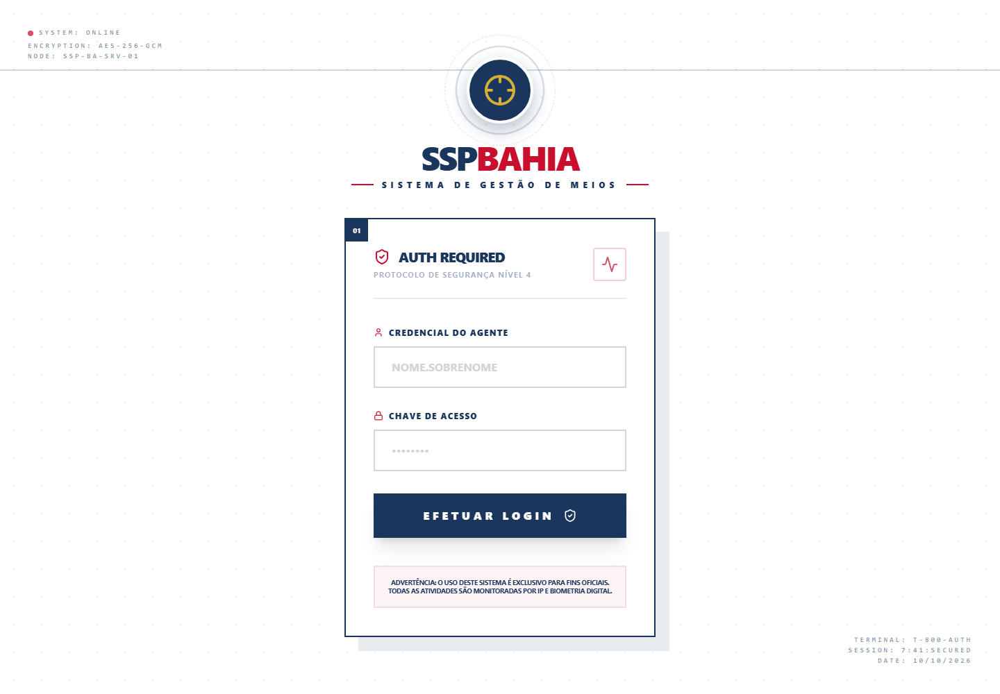
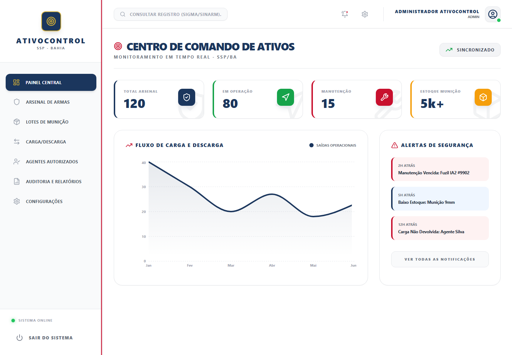
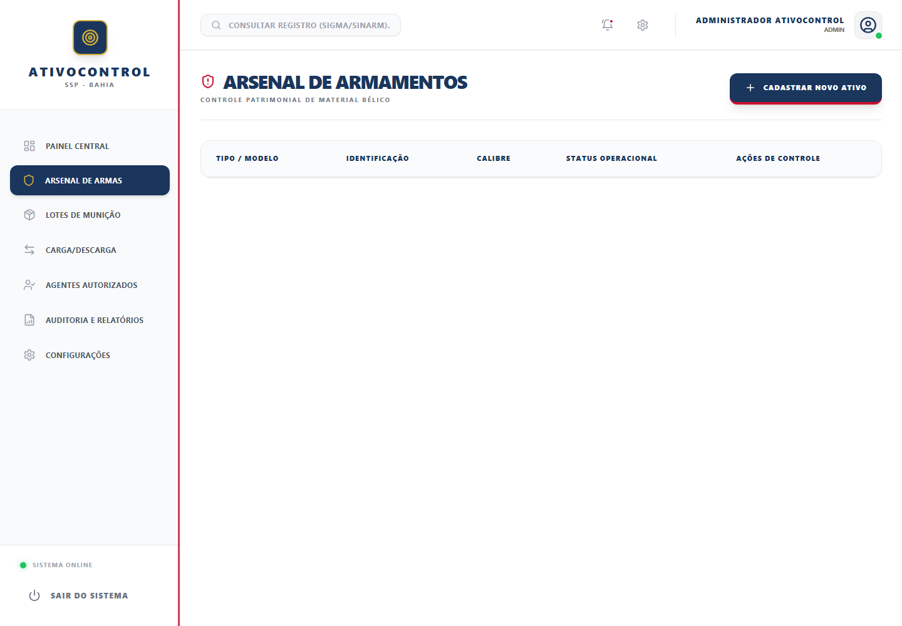
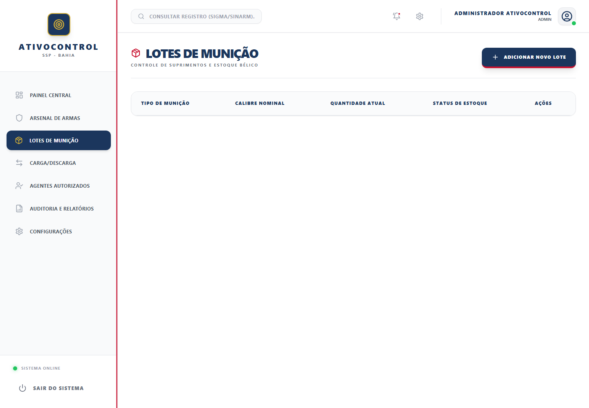
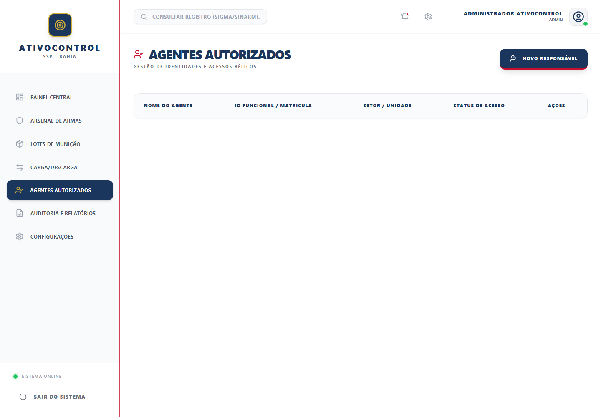
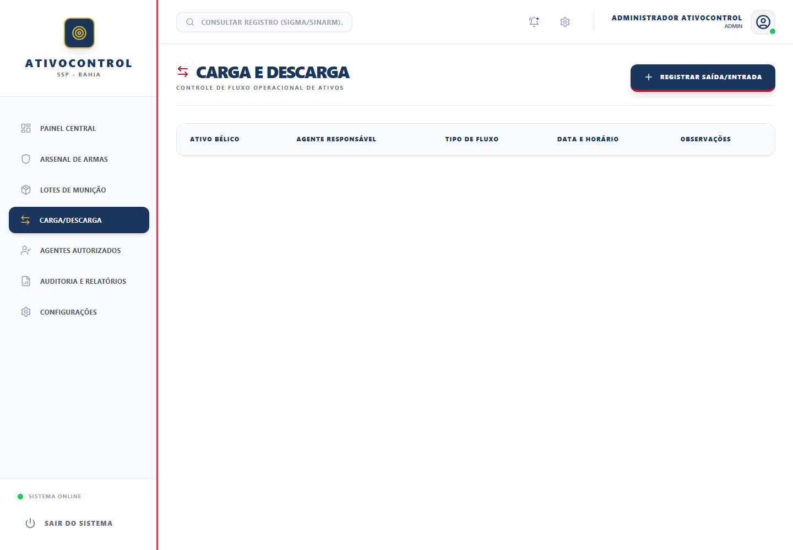
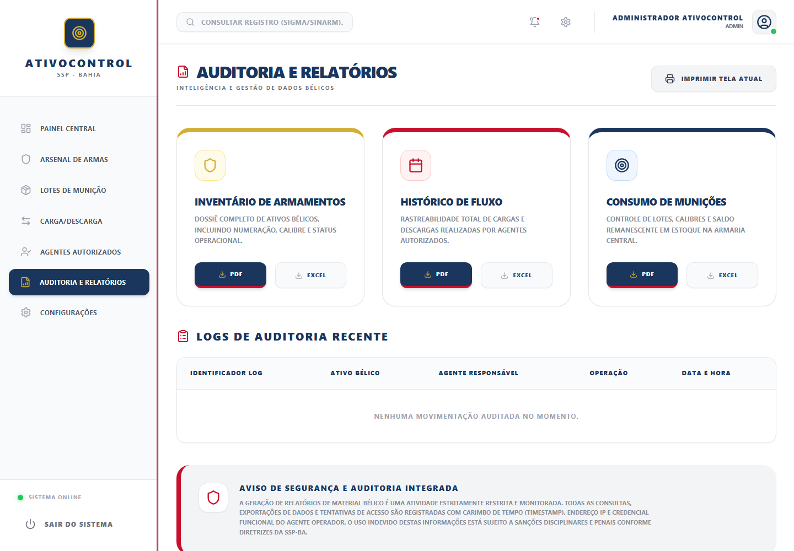
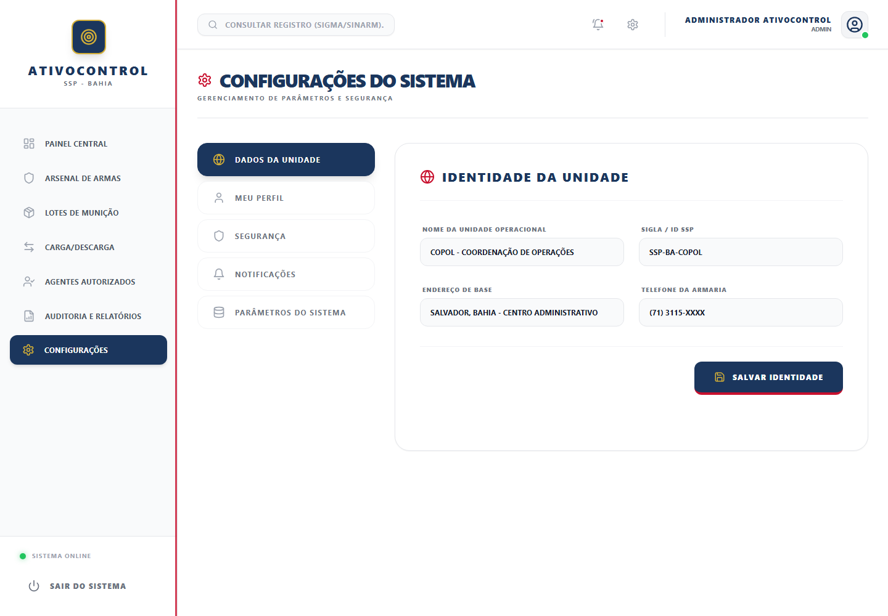
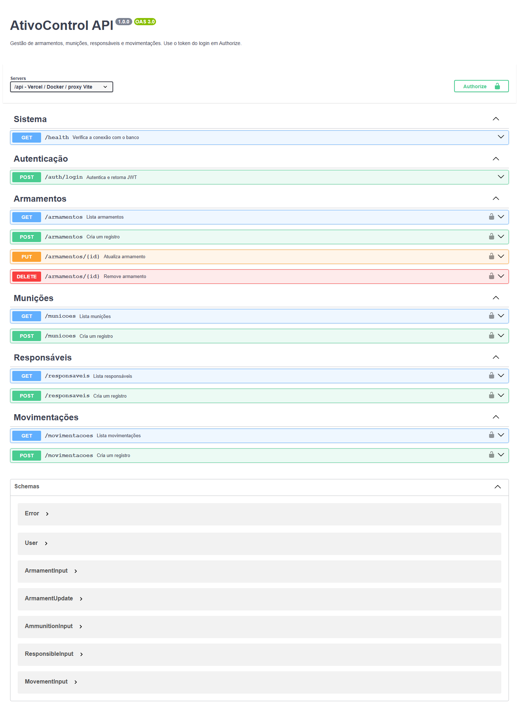
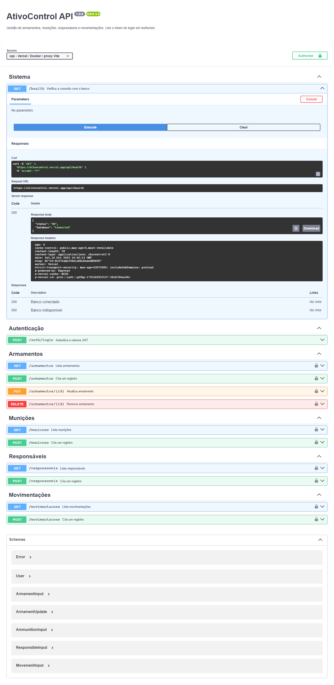

# Guia de uso, prints e vídeos

[README](../README.md) · [API](API.md) · [Aplicação](https://ativocontrol.vercel.app)

Capturas reais de 10/10/2026. As listas mostram o banco recém-criado; indicadores e alertas do dashboard são exemplos fixos.

## Vídeos

| Gravação | Conteúdo |
| --- | --- |
| [Tour da aplicação](media/tour-aplicacao.webm) | Login sem credenciais visíveis e navegação pelos módulos. |
| [Tour do Swagger](media/tour-swagger.webm) | Documentação e execução de `GET /health` contra o Neon. |

WebM sem narração. Use **View raw/Download** no GitHub. Links diretos: [aplicação](https://raw.githubusercontent.com/PauloHenrique993940/AtivoControl/main/docs/media/tour-aplicacao.webm) e [Swagger](https://raw.githubusercontent.com/PauloHenrique993940/AtivoControl/main/docs/media/tour-swagger.webm). Senhas e tokens não foram gravados.

## Login

Entre com um usuário cadastrado. O seed cria o administrador com as variáveis locais. Não há senha pública de demonstração. JWT expira em um dia; sair remove a sessão no navegador.



## Painel central

Cartões, gráfico e alertas são demonstrativos. O menu abre os módulos conectados à API.



## Armamentos

Cadastre tipo, marca, modelo, calibre, série e registro. Série e registro são únicos. A API permite listar, criar, atualizar e excluir.



## Munições

Cadastre tipo, calibre e quantidade. A API lista e cria lotes. Movimentações ainda não descontam estoque automaticamente.



## Responsáveis

Cadastre nome, identificação funcional única e setor; associe às movimentações quando necessário.



## Movimentações

Informe tipo, motivo e vínculos opcionais. O autor vem do JWT. Retirada altera status do armamento para `USO`; devolução para `ESTOQUE`.



## Relatórios

A tela consulta movimentações. PDF/Excel exibe mensagem de integração pendente, sem gerar arquivos. `AuditLog` existe no schema, ainda sem gravação automática ou API pública.



## Configurações

As abas apresentam parâmetros visuais sem endpoints de persistência. Busca e notificações também são demonstrativas.



## Swagger

Abra [Swagger](https://ativocontrol.vercel.app/api/docs). Use **Authorize** com token do login nas rotas protegidas. Para saúde do banco, expanda `GET /health`, clique em **Try it out** e **Execute**.





## Atualizar a mídia

Configure `ADMIN_EMAIL` e `ADMIN_PASSWORD` em `backend/.env`:

```sh
npm ci
npx playwright install chromium ffmpeg
npm run docs:capture
```

`DOCS_BASE_URL` permite capturar outra instalação. O script autentica, navega e consulta saúde; não modifica cadastros nem salva tokens em artefatos.
